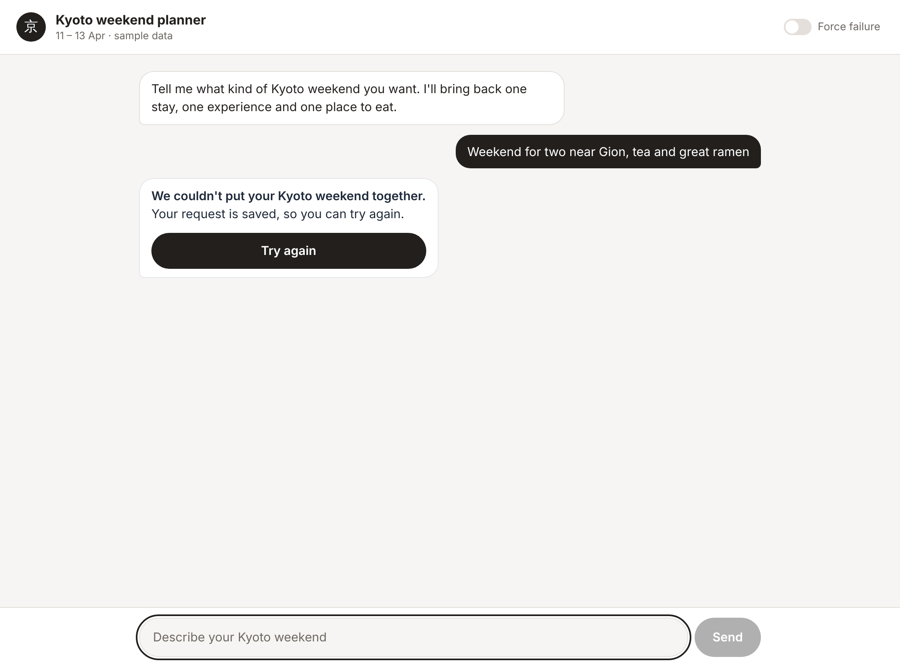

**Live prototype:** https://zeroairbnb.vercel.app

# Kyoto weekend planner

A chat prototype. One trip request returns one stay, one experience and one food spot for a weekend in Kyoto. Sample data, no login.


## Moderated session checklist

Rules copied from "Moderated Session Prototype Requirements: Trip-Planner Chat". A tick means the rule was run and seen to pass on that setup, and every line names the screenshot behind it.

**How it was tested:** against the live link, https://zeroairbnb.vercel.app, in a browser window with no cookies, saved logins or storage (the same as a private or incognito window). The phone setup is an emulated iPhone 14 (390px wide, Safari user agent, touch) and the laptop setup is a 1440px window, both in Chromium. It has not been run on a real iPhone in Safari or on a MacBook in Chrome.

**Request typed:** `Weekend for two near Gion, tea and great ramen`

| Rule | Phone | Laptop | Screenshot | What was seen |
| --- | --- | --- | --- | --- |
| Opening the link needs no install, no login and no configuration | ✅ | ✅ | [phone](docs/session/phone-open.png), [laptop](docs/session/laptop-open.png) | The page loaded straight into the chat: no login page, no redirect, no password field, in a window with no cookies |
| Only the production `*.vercel.app` domain is shared, and it loads in a private window without a login | ✅ | ✅ | [phone](docs/session/phone-open.png), [laptop](docs/session/laptop-open.png) | https://zeroairbnb.vercel.app is the only link in this README and in the team message |
| The newest deployment is the one tested | ✅ | ✅ | [phone](docs/session/phone-cards.png), [laptop](docs/session/laptop-cards.png) | The live site shows the sample-data note and the aligned cards, which are the newest app changes. I could not see the Deployments tab in Vercel itself |
| One typed trip request shows a thinking state first | ✅ | ✅ | [phone](docs/session/phone-thinking.png), [laptop](docs/session/laptop-thinking.png) | Three pulsing dots, input locked, no cards yet |
| Then 3 of 3 cards show: a stay card, an Experience card and a food card | ✅ | ✅ | [phone](docs/session/phone-cards.png), [laptop](docs/session/laptop-cards.png) | 3 of 3 cards |
| The three cards look clearly different, not one layout with the text swapped | ✅ | ✅ | [phone](docs/session/phone-cards.png), [laptop](docs/session/laptop-cards.png) | Stay: image on top, title biggest, rose. Experience: image on the left, start time biggest, teal. Food: round image on the right, cuisine biggest, amber |
| At phone width nothing is cut off and nothing needs sideways scrolling | ✅ | n/a | [phone](docs/session/phone-cards.png), [phone](docs/session/phone-error.png) | No element past the screen edge, no clipped text, no sideways scroll |
| The forced failure shows a friendly message and a "Try again" button inside the assistant bubble | ✅ | ✅ | [phone](docs/session/phone-error.png), [laptop](docs/session/laptop-error.png) | "We couldn't put your Kyoto weekend together." with the button inside the bubble |
| The chat is never empty at the moment of failure | ✅ | ✅ | [phone](docs/session/phone-error.png), [laptop](docs/session/laptop-error.png) | The error bubble takes the place of the dots |
| The chat is never empty at the moment "Try again" is pressed | ✅ | ✅ | [phone](docs/session/phone-retry-thinking.png), [laptop](docs/session/laptop-retry-thinking.png) | The dots take the place of the error bubble; the guest's message stays |
| The chat is never empty after "Try again", and the three cards come back | ✅ | ✅ | [phone](docs/session/phone-retry.png), [laptop](docs/session/laptop-retry.png) | 3 of 3 cards; the guest's message is not repeated |
| 0 blank-chat moments across both paths | ✅ | ✅ | [blank-check.json](docs/session/blank-check.json) | 0 blank of 304 samples on the phone setup and 0 blank of 305 on the laptop setup, at commit [`afe96c9`](https://github.com/ab-n-jain/Zero_Airbnb/commit/afe96c9). Full result in the table below |
| The page shows visible wording that the trips are sample data and nothing is booked | ✅ | ✅ | [phone](docs/session/phone-open.png), [laptop](docs/session/laptop-open.png) | "These trips are sample data for a prototype. Nothing is booked." under the message box, on every screen |
| The failure can be triggered without editing code | ✅ | ✅ | [phone](docs/session/phone-error.png), [laptop](docs/session/laptop-error.png) | "Force failure" switch in the header, then send any message |
| The message sharing the link says which request to type and how to trigger the failure | ✅ | ✅ | "Team message" below | The message says both and carries the production link. It still has to be posted in Slack by a person |

### Blank-chat measurement

- **Result:** 0 blank samples out of 609 across both setups and both paths.
- **What was sampled:** the newest turn in the thread, read inside the page. A sample counts as blank when that turn shows none of the thinking dots, the error bubble or a card.
- **When:** every 30 ms, from the moment the guest's message appears until 0.8 seconds after the three cards show. The same check also ran on every change to the thread, so a blank shorter than 30 ms would still be caught.
- **Where and when it ran:** against https://zeroairbnb.vercel.app on 2026-11-17 at 05:55 UTC, in a fresh browser window with no cookies or logins for each run.
- **Commit:** [`afe96c9`](https://github.com/ab-n-jain/Zero_Airbnb/commit/afe96c9), the commit `main` was at when the check ran. Vercel does not show which commit the live site is serving, so this is the repo state at test time; the app code has not changed since [`69c07dc`](https://github.com/ab-n-jain/Zero_Airbnb/commit/69c07dc).
- **Raw result and script:** [docs/session/blank-check.json](docs/session/blank-check.json), produced by [scripts/blank-check.js](scripts/blank-check.js).

| Setup | Path | Samples | Showing dots | Showing error bubble | Showing cards | Blank | Blank thread changes | Sampled for | Longest gap between samples |
| --- | --- | --- | --- | --- | --- | --- | --- | --- | --- |
| Phone | Send, then cards | 104 | 69 | 0 | 35 | **0** | 0 of 2 | 3.1 s | 38.7 ms |
| Phone | Forced failure, Try again, then cards | 200 | 129 | 33 | 38 | **0** | 0 of 4 | 6.0 s | 35.9 ms |
| **Phone total** | Both paths | **304** | 198 | 33 | 73 | **0** | 0 of 6 | 9.1 s | 38.7 ms |
| Laptop | Send, then cards | 104 | 67 | 0 | 37 | **0** | 0 of 2 | 3.1 s | 31.9 ms |
| Laptop | Forced failure, Try again, then cards | 201 | 129 | 32 | 40 | **0** | 0 of 4 | 6.0 s | 39.2 ms |
| **Laptop total** | Both paths | **305** | 196 | 32 | 77 | **0** | 0 of 6 | 9.1 s | 39.2 ms |

**About the "Blank thread changes" column:** it counts how many times the thread changed during the run, and how many of those changes left the newest turn blank. `blank-check.json` holds only these counts; it does not record what each change was. Reading the 2 changes as "the message and dots appear, then the cards replace the dots", and the 4 changes as "the message and dots appear, the error bubble replaces the dots, the dots replace the error bubble, then the cards replace the dots", is worked out from the order of the flow, not taken from the run log.

All twelve screenshots are in `docs/session/` and were taken from the live link. The phone card screenshots are taller than the phone screen so all three cards fit in one image; on the device the guest scrolls the thread to see them.

## Team message

To post in #search-trip-planner on Slack for Hannah Brooks, Tomás Herrera, Priya Raman and Daniel Okafor, once the production Vercel link is live and has been opened in a private window. Replace the link placeholder with the production `*.vercel.app` domain, never a preview link.

> Hi Hannah, Tomás, Priya and Daniel. The trip-planner chat prototype is ready for Thursday's dry run (13 March), ahead of the first guest sessions on 1 April.
>
> Link: https://zeroairbnb.vercel.app
>
> It opens with no login or install, on phone and laptop. The trips are sample data and nothing is booked.
>
> To see the cards: type "Weekend for two near Gion, tea and great ramen" and press Send.
>
> To see the failure: turn on "Force failure" in the header, send any request, then press "Try again".
>
> Tell me here if anything looks off.

## What it does

- **Chat page:** a header, a scrolling thread and a send button.
- **Thinking state:** on send, the input and button lock and three pulsing dots show in the reply bubble until the cards arrive.
- **Mock reply:** `POST /api/plan` waits 1.8 seconds and returns the same sample reply for any message.
- **Forced failure:** turn on the "Force failure" switch in the header, then send any message; that one request gets a broken answer (`"forceFail": true`), and the switch turns itself off.
- **Three cards**, each its own component with its own layout:

| Card | Image box | Biggest text | Accent |
| --- | --- | --- | --- |
| Stay | Top, full width | Listing title | Rose |
| Experience | Left side | Start time | Teal |
| Food spot | Right side, round | Cuisine | Amber |

On a laptop the stay card sits beside the other two. On a phone the cards stack in the same order.

## When an answer breaks

A broken answer shows a friendly bubble in place of the thinking dots. Try again sends the same request without the broken answer, so the dots play and the three cards appear.

The error bubble, after a forced failure:



The three cards, after clicking Try again:


## Sample data

The reply in `lib/sampleReply.ts` is typed by hand from one row per sheet of the "Kyoto Weekend Prototype Content Pack" workbook:

| Sheet | Option ID | Row |
| --- | --- | --- |
| Stays | S1 | Restored machiya townhouse near Gion |
| Experiences | E1 | Tea ceremony in a 100-year-old machiya |
| Food | F1 | Menya Inoichi |

Each item's keys are its sheet's column names (`Listing Title`, `Experience Title`, `Place Name`, `Neighbourhood`, `Price per Night (USD)` and so on), and the values are the row's cells as the workbook has them. The cards format them for display, for example `2025-04-12` as "12 Apr" and `10:30` as "10:30 AM".

Two keys are not workbook columns: `type` labels the card and `art` picks a placeholder illustration, because the pack has no photos. A blank cell shows as the filler text "To be added"; these three rows have no blank cells.

## Run it

```bash
npm install
```

```bash
npm run dev
```

Then open http://localhost:3000 and send a trip request.

## Where things are

All styling is Tailwind CSS. The colours, fonts and the dots animation are defined once in `app/globals.css`.

- `components/Chat.tsx`: the thread, the input lock and the request
- `components/ThinkingBubble.tsx`: the pulsing dots
- `components/ErrorBubble.tsx`: the message and Try again button shown when an answer is broken
- `components/bubble.ts`: the bubble shape shared by every assistant reply
- `components/cards/`: `StayCard`, `ExperienceCard`, `FoodCard` and the placeholder art
- `app/api/plan/route.ts`: the mock reply
- `lib/sampleReply.ts`, `lib/types.ts`: the sample reply and its shape
- `lib/brokenReply.ts`, `lib/validateReply.ts`: the broken answer and the check that catches it
